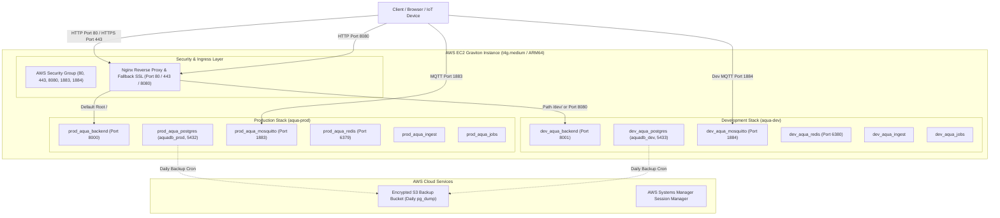

# Aqua OS Platform: AWS EC2 Graviton Cloud Infrastructure Guide

This directory contains the automated scripts and architectural specifications for deploying the **Aqua OS** backend stack on an **AWS EC2 Graviton (ARM64)** instance with strict Development (`aqua-dev`) and Production (`aqua-prod`) isolation.

---

## 1. Architecture Overview (No Dedicated Domain Mode)

When operating **without a dedicated domain**, the EC2 public IP (or Elastic IP) serves both environments concurrently using an Nginx reverse proxy:



---

## 2. Ingress & Routing Table (IP-Based Without Custom Domain)

| Environment | Protocol | URL / Ingress Endpoint | Proxied To | Description |
| :--- | :--- | :--- | :--- | :--- |
| **Production** | HTTP | `http://<EC2_PUBLIC_IP>/` | `127.0.0.1:8000` | Main Production API |
| **Production** | HTTPS | `https://<EC2_PUBLIC_IP>/` | `127.0.0.1:8000` | Prod API with self-signed SSL |
| **Development** | HTTP | `http://<EC2_PUBLIC_IP>/dev/` | `127.0.0.1:8001` | Dev API via `/dev/` path |
| **Development** | HTTP | `http://<EC2_PUBLIC_IP>:8080/` | `127.0.0.1:8001` | Dev API via port 8080 |
| **Development (Wildcard DNS)** | HTTP | `http://dev.<EC2_PUBLIC_IP>.sslip.io/` | `127.0.0.1:8001` | Free zero-config hostname |
| **Production MQTT** | MQTT | `<EC2_PUBLIC_IP>:1883` | `prod_aqua_mosquitto:1883` | Production Telemetry Broker |
| **Development MQTT** | MQTT | `<EC2_PUBLIC_IP>:1884` | `dev_aqua_mosquitto:1883` | Dev Simulator / Test Broker |

---

## 3. EC2 Graviton Instance Sizing & Cost

| Instance Type | vCPU | RAM | Architecture | Approx Cost (ap-south-1) | Recommended Use Case |
| :--- | :---: | :---: | :---: | :---: | :--- |
| **t4g.small** | 2 | 2 GB | ARM64 (Graviton2) | ~$12.26 / month | Minimal starter (requires 4GB swap enabled) |
| **t4g.medium** | 2 | 4 GB | ARM64 (Graviton2) | ~$24.53 / month | **Recommended:** Runs both Prod and Dev smoothly with full TimescaleDB caches |

- **Storage Volume:** 40 GB EBS `gp3` (3000 IOPS, 125 MB/s baseline throughput) with KMS encryption enabled (~$3.20/month).

---

## 4. Provisioning Step-by-Step

### Step 1: Provision AWS Cloud Resources (Security Group, IAM, S3)
Run from any machine configured with AWS CLI:
```bash
chmod +x deployment/aws/setup_aws_resources.sh
./deployment/aws/setup_aws_resources.sh
```
This automatically sets up:
1. Inbound Security Group (`aqua-ec2-sg`) opening 80, 443, 8080, 1883, 1884. Direct database ports (5432, 6379) remain strictly blocked from the internet.
2. IAM Role & Instance Profile (`AquaEC2InstanceProfile`) with AWS Systems Manager (SSM) access (no SSH keys needed) and S3 backup permissions.
3. Private AES-256 encrypted S3 backup bucket (`aqua-backups-<ACCOUNT_ID>-<REGION>`) with Glacier lifecycle transition.

### Step 2: Launch the EC2 Graviton Instance
Launch using the AWS CLI command output from Step 1:
```bash
aws ec2 run-instances \
  --image-id resolve:ssm:/aws/service/canonical/ubuntu/server/24.04/stable/current/arm64/hvm/ebs-gp3/ami-id \
  --instance-type t4g.medium \
  --iam-instance-profile Name=AquaEC2InstanceProfile \
  --security-group-ids <SG_ID> \
  --block-device-mappings '[{"DeviceName":"/dev/sda1","Ebs":{"VolumeSize":40,"VolumeType":"gp3","Encrypted":true}}]' \
  --user-data file://deployment/aws/bootstrap_ec2.sh \
  --tag-specifications 'ResourceType=instance,Tags=[{Key=Name,Value=aqua-graviton-host}]'
```

The `bootstrap_ec2.sh` script automatically runs on first boot to:
- Install Docker Engine & Docker Compose (ARM64).
- Allocate 4GB Swap Space.
- Configure Docker log rotation (`max-size: 50m`).
- Setup Nginx reverse proxy with IP routing.
- Generate self-signed SSL for fallback HTTPS.
- Install AWS SSM Agent.

### Step 3: Deploy Applications
Connect via AWS SSM (or SSH) and deploy the stacks:
```bash
# Connect via AWS Systems Manager (zero open SSH ports)
aws ssm start-session --target <INSTANCE_ID>

cd /opt/aqua-firmware

# Deploy Development Stack
./deployment/scripts/deploy_dev.sh

# Deploy Production Stack
./deployment/scripts/deploy_prod.sh

# Enable Automated Daily S3 Backups
./deployment/scripts/setup_cron_backups.sh
```

---

## 5. Transitioning to a Dedicated Domain in the Future

When you register a dedicated domain (e.g., `aquaos.com`), follow this 1-step migration:
1. Create DNS A records in Route 53 or your DNS registrar pointing to your EC2 Elastic IP:
   - `api.aquaos.com` -> `<EC2_ELASTIC_IP>`
   - `api-dev.aquaos.com` -> `<EC2_ELASTIC_IP>`
2. Run the automated upgrade script:
   ```bash
   sudo ./deployment/nginx/scripts/switch_to_domain.sh aquaos.com devops@aquaos.com
   ```
This automatically issues Let's Encrypt SSL certificates, enables HTTP->HTTPS redirection, and switches Nginx to domain virtual hosts with zero downtime.
